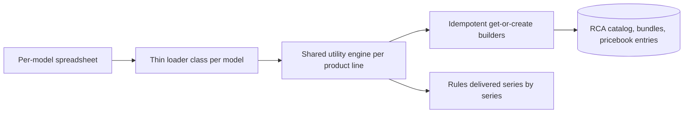

<h1 align="center">Hi, I'm Shivam Tripathe👋</h1>
<h3 align="center">Lead Salesforce Developer  · Speaker</h3>

  <b>I turn complex business processes into scalable Salesforce solutions.</b>

  
  
  
  

  
  
  
  <a href="<BLOG_URL>"></a>

---

## 🧑‍💻 About me
I build enterprise Salesforce solutions across **Revenue Cloud Advanced, Agentforce, Health Cloud, B2B Commerce, Experience Cloud and Sales Cloud**. I also work as a solutions architect, scoping Revenue Cloud implementations and designing integrations across Salesforce, Microsoft Graph, Supabase, Shopify and other platforms.

- 📦 **2 apps published on AppExchange**: a RevOps tracking app and a Shopify ↔ Salesforce sync tool
- 💰 Built a **~7,000-product Revenue Cloud Advanced catalog** with scripted configuration rules
- 🤖 Building AI agents with **Agentforce** (Agent API, invocable actions, Experience Cloud)
- 🔌 Designing **REST and webhook integrations** with retry, routing and governor-limit-safe async processing
- 🎤 Speaking at **Slack Community Ajmer** (31 Oct 2026): *Stop Switching Tabs*, on Slack + Salesforce integration
- ✍️ Writing about Salesforce development tips, Git workflows and DevOps

---

## 🛠️ Tech stack

  
  
  
  
  
  
  
  
  
  
  
  
  
  
  

---

## 📦 Published apps
| App | What it does | My part |
|---|---|---|
| **SaaSTrack** ([AppExchange](<APPEXCHANGE_LINK_1>)) | SaaS revenue-operations tracking app | Complete LWC user interface, dynamic field-mapping logic, and a complex integration issue investigated and resolved |
| **Shopify ↔ Salesforce Integration Tool** ([AppExchange](<APPEXCHANGE_LINK_2>)) | Managed package that syncs Shopify metafields with Salesforce in both directions | Bidirectional sync, plus a without-sharing executor pattern that fixed guest-user record creation (now being applied to a second package) |

---

## 🚀 Featured projects
*Client work is described without client names or proprietary data. Repos marked "sample" contain sanitized, generic code only.*

| Project | What it shows |
|---|---|
| [**Revenue Cloud catalog loader (sample)**](https://github.com/cybershivamtiwari/rca-catalog-loader-sample) | Idempotent get-or-create Apex builders for Revenue Cloud Advanced catalogs, bundles and rules |
| [**Agentforce Agent API demo**](https://github.com/cybershivamtiwari/swift-pizza-agentforce-demo) | Agentforce + custom LWC chat with OAuth client-credentials and SSE streaming |
| [**Batched AI callout pattern (sample)**](https://github.com/cybershivamtiwari/batched-ai-callout-pattern) | One batched Gemini call through a Named Credential instead of per-record callouts that hit HTTP 429 |
| [**System context executor (sample)**](https://github.com/cybershivamtiwari/system-context-executor) | Reusable without-sharing executor for guest-user record creation |

<b>💰 Revenue Cloud Advanced: product catalog and rules (~7,000 products)</b>

**Problem:** a machine-tool distributor quoted from Excel and priced each line by hand.

**Built:** a flat catalog (manufacturer → one category per series) on **standard RCA objects only**, with classification, spec attributes, bundles, component groups per option header, base and option child products and price book entries. Attributes are set so they don't show as overridden inherited attributes. Exclusion, requirement and prerequisite rules are delivered series by series after the bundles; **317 configuration rules** (55 variant-restriction rules) were created by scripting the Rule Library `createRule` call, since Apex DML isn't allowed on `ProductConfigurationRule`.

**Challenges solved:** controls arrive as separate option sheets per control type; some machines have controls built into the machine sheet; manufacturers reuse option codes across model families, so option codes carry the model code to keep SKUs unique.

**Method:**

Rules: parse only the last tab of multi-tab sheets, required components must also be default, and ambiguous cells are flagged as numbered comments in the class header instead of guessed. Written handoff notes let another engineer continue without rework.

**Stack:** Apex, Revenue Cloud Advanced, spreadsheet parsing

<b>🤖 Agentforce Agent API demo (pizza ordering)</b>

OAuth client-credentials flow in server-side Apex, Server-Sent Events streaming in the browser, an LWC chat interface and an LWC design system built on CSS custom properties. Four invocable action classes delegate to a shared service layer on the standard Order object. Resolved CSP `connect-src` errors, guest-user Apex access and email-domain verification. Includes anonymous Apex test-data setup (Account, Contract, Orders, OrderItems with activation ordering).

**Stack:** Agentforce, Apex, LWC, Experience Cloud

<b>🔁 License and renewal automation</b>

**Problem:** per-product HTTP callouts for expiry-date prediction hit HTTP 429 rate limits.

**Built:** one batched Gemini API call through a Named Credential, with date validation, server-side override guards and fallback dates. Added a duplicate-renewal guard, filtered null entries from JSON payloads, enforced product-code rules and fixed LWC product selection across search and pagination. Built a multi-step opportunity workflow with Slack channel selection, pre-populated from prior closed opportunities. Fixed a cross-origin "Script error" caused by Aura's global error handler.

**Stack:** Apex, LWC, Gemini API, Slack

<b>🛒 Commerce: UK healthcare storefront and product detail page</b>

- **Storefront:** an unlicensed-medicines experience with a dedicated category and listing page, per-product leaflet link, basket detection modal, terms acceptance and a regulatory guidance disclaimer; a Handlebars helper detects unlicensed products in the cart.
- **Incident handling:** a release caused a problem across several storefronts. I rolled it back, fixed the cause (service workers, browser cache and script timing) and re-released after smoke testing.
- **Product detail page:** rebuilt from Figma on an existing Visualforce + Handlebars + JavaScript code base (price and quantity card, live total, favourites icon, Switch & Save-style pricing table) and built a product recommender in the same stack.

**Stack:** Visualforce, Aura, Handlebars, JavaScript, CSS

<b>📦 Order Management: ShipStation tracking</b>

A bulkified tracking service with test coverage for `OrderSummary` updates, working around ConnectApi limits in data-siloed tests and the non-writable `OriginalOrderId`.

**Stack:** Apex, Order Management, ShipStation API

<b>🔌 Integrations and middleware</b>

- **Microsoft Graph + Supabase + Salesforce:** as Salesforce architect on a statement of work, built the Day 1 webhook ingestion layer (Supabase Deno edge functions) and the Salesforce-side configuration.
- **SharePoint (Microsoft Graph):** Apex callouts with Named Credentials to read and write files; resolved a redirect URI mismatch and a missing ID token.
- **Node.js SFTP middleware:** `ssh2-sftp-client` on AWS EC2 moving CSV files between Salesforce and an SFTP server.
- **Google Drive and Sheets:** OAuth 2.0 against Google Cloud APIs, with requests designed and tested in Postman.
- **Healthcare REST integration:** bidirectional sync with a third-party platform using Queueable Apex, record-triggered flows, webhooks, retry processing and Named Credentials, with location-based payload routing. Solved invalid-session, row-locking and governor-limit failures in production.

<b>🎓 Experience Cloud: learning portal and preference center</b>

LWC screens for the home page, course catalogue, course detail (single- and multi-session, standard-user and school-administrator views) and staff registration, backed by custom objects for Course, Session, Enrollment and Staff, record types, enrollment automation, email notifications, role-based access and Apex tests. Plus an Experience Cloud preference center for email, phone and SMS subscriptions.

---

## 🏅 Certifications
All verifiable on my [Trailblazer profile](https://www.salesforce.com/trailblazer/dynaamo).

| Certification |
|---|
| Salesforce Certified Agentforce Specialist |
| Salesforce Certified Platform Developer I |
| Salesforce Certified Platform Foundations |
| Salesforce Certified AI Associate |

**Recognition:** Star Performer (2025) · Shining Star (2025) · Support Excellence (2024) · Dedicated Dynamo (2024)

---

## 🌱 Craft, teaching and early work
- 🎓 **Training:** built course decks and graded assignments on Apex triggers, Apex fundamentals, SOQL, SOSL and collections, and tracked a 60+ student cohort across 20+ assignments
- 🧩 **Apex trigger architecture:** trigger handlers, bulkified logic and fixes for "Too many SOQL queries: 101"
- 🏆 **Smart India Hackathon 2022 (Grand Finalist):** led a 5-member team to the Grand Finale (25–26 Aug 2022) with a MERN app for athletes to book doctor appointments and schedule meetings
- 📊 **IIT Guwahati Summer Analytics 2022:** six-week data science and machine learning course ending in a 3-project hackathon
- 🎓 **B.Tech in Computer Science and Engineering**, Greater Noida Institute of Technology (2019–2023), CGPA 8.2

---

## 📊 GitHub stats

  
  

<i>Automate the boring, architect the complex.</i>

